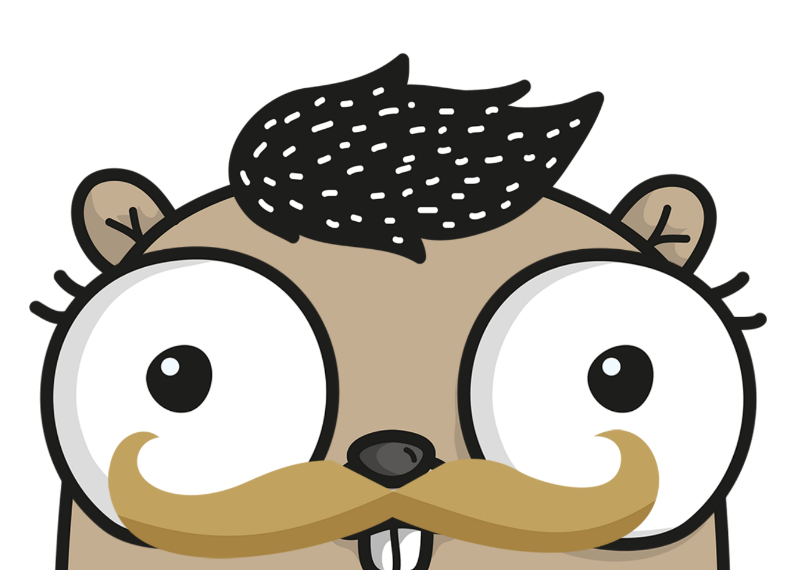

# Gopherize.me



* Code for [Gopherize.me](https://gopherize.me)

## Artwork

The artwork is stored in the default Google Cloud Storage account for the app.

Inside the `artwork` folder, each folder represents a category of items from which 
users may select one feature. A feature is a PNG image that is overlaid in category order to
build up the final image.

An example artwork structure might look like this:

```
artwork/
	000-Category1/
		Feature1.png
		Feature2.png
		Feature3.png
	010-Category2/
		Feature1.png
		Feature2.png
		Feature3.png
	020-Category3/
		Feature1.png
		Feature2.png
		Feature3.png
```

### Rules

* Filenames are important, as case is preserved
* Underscores become spaces (so `Pirate_Beard.png` will become `Pirate Beard` in the UI)
* Numbers (e.g. `010-`) are stripped from category names, but used to preserve ordering
* All images must be PNG format
* All images must be the same size
* Images must be publicly accessible (setting in Google Cloud Storage)

## Deploying

The main app uses Go 1.26 and App Engine's bundled services SDK v2.
`gae/app.yaml` preserves the existing `gopherizeme.appspot.com` bucket through
`BUCKET_NAME`; use that environment variable when running locally too.

Run `go test -race ./...` before deployment. To test a version without changing
live traffic:

```sh
gcloud app deploy gae/app.yaml --project=gopherizeme --version=VERSION --no-promote --no-stop-previous-version
```

Check the version URL's homepage, artwork API, render API, and save flow before
promoting it with `gcloud app services set-traffic default
--project=gopherizeme --splits=VERSION=1`. Keep the previous version available
for rollback.

The app uses an F2 instance with a 350 MiB Go memory target. Image renders run
one at a time per instance and composite layers sequentially. Saving reuses the
rendered PNG instead of rendering a second time. This avoids the previous F1
memory exhaustion under concurrent image saves. F2 instances have a higher
hourly rate than F1 instances.
